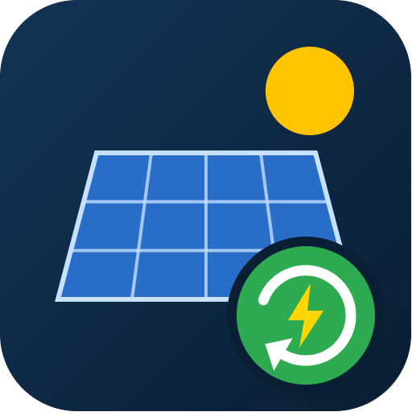

  

# Tigo Energia Recuperata

**[Italiano](#italiano) · [English](#english)**

---

## Italiano

Integrazione personalizzata per **Home Assistant** che legge **un solo dato** dal cloud Tigo: l'**energia recuperata oggi** dagli ottimizzatori TS4 (quella che il portale Tigo EI chiama *Energia recuperata* / *Solar Reclaimed*).

È pensata per chi vuole solo questo valore, senza tutti gli altri sensori di produzione, pannelli e stringhe.

### Cosa crea

| Entità | Unità | Descrizione |
|---|---|---|
| `sensor.<impianto>_energia_recuperata_oggi` | kWh | Energia recuperata nel **giorno di calendario** in corso. Tigo la azzera a mezzanotte (fuso orario dell'impianto). |

- Il sensore **non** ha `device_class: energy`, quindi **non compare nella dashboard Energia**: è un valore giornaliero, non un contatore totale.
- Ha `state_class: measurement`, quindi Home Assistant conserva lo storico e le statistiche a lungo termine (il massimo di ogni giorno è l'energia recuperata di quel giorno).

### Requisiti

- Un account **Tigo** con accesso ai dati del proprio impianto (le stesse credenziali di [ei.tigoenergy.com](https://ei.tigoenergy.com) / app Tigo).
- Home Assistant 2025.1 o successivo.

### Installazione

**Con HACS (consigliato)**

1. HACS → menu ⋮ → **Repository personalizzati**.
2. Incolla `https://github.com/nebbiadigiorno/ha-tigo-recuperata`, categoria **Integrazione**, poi **Aggiungi**.
3. Cerca **Tigo Energia Recuperata**, installala e **riavvia Home Assistant**.

**Manuale**

1. Copia la cartella `custom_components/tigo_recuperata` dentro la cartella `custom_components` della configurazione di Home Assistant.
2. Riavvia Home Assistant.

### Configurazione

1. **Impostazioni → Dispositivi e servizi → Aggiungi integrazione → Tigo Energia Recuperata**.
2. Inserisci email (o nome utente) e password dell'account Tigo.
3. Se l'account ha più impianti, scegli quello da leggere.

Durante la configurazione l'integrazione verifica subito che il dato sia leggibile: se Tigo lo rifiuta, la configurazione si interrompe con un messaggio chiaro.

### Opzioni

Dal pulsante **Configura** dell'integrazione puoi scegliere **ogni quanto interrogare Tigo**, da **1 a 24 ore** (predefinito: 1 ora). Meno chiamate = meno traffico verso il cloud Tigo.

> Il valore si riferisce sempre al giorno di calendario in corso. Con intervalli lunghi viene letto poche volte al giorno, quindi il sensore può mostrare il valore di metà giornata fino alla lettura successiva.

### Come funziona

- **Login**: lo stesso usato dall'app Tigo (`mapi.tigoenergy.com`); se non riesce, prova il login dell'API v3 (`api2.tigoenergy.com`).
- **Token**: viene salvato nella configurazione dell'integrazione e riutilizzato, così un riavvio non rifà il login. Se scade o viene rifiutato, viene rifatto il login una volta; se le credenziali non sono più valide, Home Assistant chiede di reinserirle.
- **Dato**: `GET /api/v4/fleet/system/overview/data-lifetime?sysid=<id>&range=day`, campo `reclaimed` (Wh), convertito in kWh.

### Convivenza con altre integrazioni Tigo

Usa un dominio proprio (`tigo_recuperata`), un proprio login e nessun file condiviso: può essere installata insieme ad altre integrazioni Tigo (per esempio quelle locali o cloud già esistenti) senza conflitti di configurazione.

### Avvertenze

- L'endpoint dell'energia recuperata è quello usato dal portale e dall'app Tigo e **non è documentato pubblicamente**: Tigo potrebbe cambiarlo in futuro.
- Progetto **non ufficiale**, non affiliato né approvato da Tigo Energy, Inc.

---

## English

Custom **Home Assistant** integration that reads **a single value** from the Tigo cloud: the **energy reclaimed today** by the TS4 optimizers (what the Tigo EI portal calls *Solar Reclaimed*).

It is meant for people who only want this value, without all the other production, panel and string sensors.

### What it creates

| Entity | Unit | Description |
|---|---|---|
| `sensor.<system>_energy_reclaimed_today` | kWh | Energy reclaimed during the current **calendar day**. Tigo resets it at midnight (system time zone). |

- The sensor has **no** `device_class: energy`, so it is **not offered in the Energy dashboard**: it is a daily value, not a lifetime meter.
- It has `state_class: measurement`, so Home Assistant keeps history and long-term statistics (each day's maximum is that day's reclaimed energy).

The entity ID depends on your Home Assistant language (with Italian it is `..._energia_recuperata_oggi`).

### Requirements

- A **Tigo** account with access to your system data (the same credentials as [ei.tigoenergy.com](https://ei.tigoenergy.com) / the Tigo app).
- Home Assistant 2025.1 or later.

### Installation

**With HACS (recommended)**

1. HACS → ⋮ menu → **Custom repositories**.
2. Paste `https://github.com/nebbiadigiorno/ha-tigo-recuperata`, category **Integration**, then **Add**.
3. Search for **Tigo Energia Recuperata**, install it and **restart Home Assistant**.

**Manual**

1. Copy `custom_components/tigo_recuperata` into the `custom_components` folder of your Home Assistant configuration.
2. Restart Home Assistant.

### Configuration

1. **Settings → Devices & services → Add integration → Tigo Energia Recuperata**.
2. Enter the email (or username) and password of your Tigo account.
3. If the account has several systems, pick the one to read.

During setup the integration immediately checks that the value can be read: if Tigo refuses it, setup stops with a clear message.

### Options

From the integration's **Configure** button you can choose **how often Tigo is polled**, from **1 to 24 hours** (default: 1 hour). Fewer calls = less traffic to the Tigo cloud.

> The value always refers to the current calendar day. With long intervals it is read only a few times a day, so the sensor may show a mid-day value until the next poll.

### How it works

- **Login**: the same one used by the Tigo app (`mapi.tigoenergy.com`); if it fails, the v3 API login (`api2.tigoenergy.com`) is tried.
- **Token**: stored in the integration's config entry and reused, so a restart does not log in again. If it expires or is refused, the integration logs in again once; if the credentials are no longer valid, Home Assistant asks for them again.
- **Data**: `GET /api/v4/fleet/system/overview/data-lifetime?sysid=<id>&range=day`, field `reclaimed` (Wh), converted to kWh.

### Running alongside other Tigo integrations

It uses its own domain (`tigo_recuperata`), its own login and no shared files, so it can be installed next to other Tigo integrations (for example existing local or cloud ones) without configuration conflicts.

### Disclaimer

- The reclaimed-energy endpoint is the one used by the Tigo portal and app and is **not publicly documented**: Tigo may change it in the future.
- **Unofficial** project, not affiliated with or endorsed by Tigo Energy, Inc.

---

License: [MIT](LICENSE)
